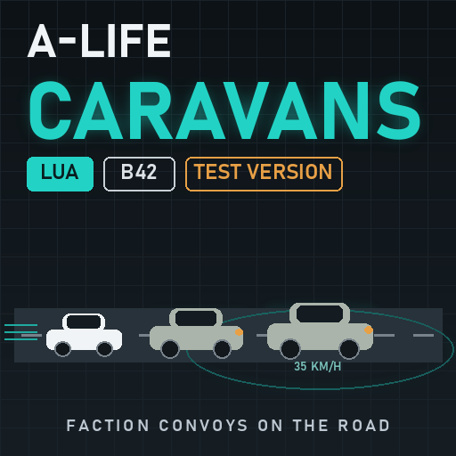

# A-Life: Caravans [B42] — test version

An add-on for [Project A-Life [ALIFE NPCS]](https://steamcommunity.com/sharedfiles/filedetails/?id=3803984183) (by Vice):
faction caravans and convoys drive the roads between towns at low speed (35 km/h by default), so you can catch up
in your own car. Flag them down, ask for news, trade, hitch a ride to their town, pay a raider's toll, or threaten
them and see what the faction does. Project A-Life itself is not changed and none of its code is copied; this is a
separate Lua mod built on A-Life's public NPC driving, arrival and speech functions.

> **Test version.** 0.1.0 has passed the simulation tests and loads in the game, but it has not been played in a
> real session yet. It is out so players can test it: please report bugs (what the caravan did + your
> `Zomboid/console.txt`) in the Steam comments or the Issues here. Multiplayer is the least tested part.

**Steam Workshop:** https://steamcommunity.com/sharedfiles/filedetails/?id=3829571361 · **Source code (MIT):** https://github.com/druidqwerty/ALifeCaravans

Free and open source. The code is written by an AI; the direction, the testing and the time are mine. If the mod made your game better: [support on Boosty](https://boosty.to/lrgpp).

Русская версия: [README_RU.md](README_RU.md)

## What it does

- **Caravans on the roads.** Up to three caravans (Sandbox) exist at once. Each belongs to an A-Life faction and has a
  crew of 3-5 NPCs in one or two cars. The faction decides the kind: soldiers run a **military convoy**, police a
  **patrol**, medics and firemen a **rescue crew**, workers and civilians a **trade caravan**, gangs and raiders a
  **raid** party.
- **Town to town.** A caravan travels A-Life's road graph from one town to another (2-4 legs), then picks the next
  town; after two trips it retires and a new one is founded. While nobody is near it travels in a ledger
  (25 % of the cruising speed, it stops and detours). When a player comes within 100 tiles it is put on the road
  for real: the cars appear on a free stretch of road at least 45 tiles away, the crew sits inside, and the convoy
  drives on along the road at 35 km/h (soldiers 30, raiders 40). Beyond 170 tiles from every player it goes back
  into the ledger and continues its trip there.
- **Low speed on purpose.** You can catch up in any car, overtake, or block the road. A driver stuck behind you
  for a few seconds says so ("Clear the road!"). A convoy passing a player on foot tells them to stay off the road.
- **Flag them down.** Right-click near a caravan car (within 18 tiles): *[A-LIFE] Caravan: <faction> (<kind>)*.
  Or honk within 30 tiles. Friendly and neutral crews pull over and wait 2 minutes; careful ones refuse half the
  time; hostile factions tell you to get off the road, and raiders stop you for a **toll** instead.
- **Talk.** *Ask for news*: where they are going, what they saw on the road, rumours. *Ask them to wait*: up to two
  more minutes. *Let them go*: they drive on.
- **Trade.** A stopped non-hostile caravan sells 4-6 goods for **cash** (Base.Money): traders carry food, water,
  bandages, fuel, ammo, tools; convoys ammo and medical kits; rescue crews medical supplies; patrols a little of
  everything. Prices vary, stock is limited.
- **Hitch a ride.** A stopped friendly or neutral caravan lets you take a free seat (the normal "Enter vehicle" on
  the car) to its destination town. Get out whenever you like.
- **Threaten them.** Traders and civilians hand over an item and flee (15 km/h faster). Soldiers, police and
  raiders stop, dismount and fight. A threat counts as a provocation for A-Life's reputation.
- **Attack them** (shoot or hit a crew member): traders flee, fighters dismount and return fire; A-Life's own
  reputation and grudges apply.
- **Raider toll.** A raider caravan that stops you demands 60 cash. *Pay the toll*: a 30-minute truce with that
  crew. Refuse or threaten them: they fight.
- **Speech lines in English and Russian** through A-Life's own speech bubbles (the driver answers).

Everything uses A-Life's own NPC driving: real cars with physics, road navigation, obstacle avoidance, reversing
when stuck, crews seated inside, and in multiplayer A-Life's hand-off of the car to the nearest player's game.

## Requirements

- Build 42.21+.
- [Project A-Life [ALIFE NPCS]](https://steamcommunity.com/sharedfiles/filedetails/?id=3803984183) 1.4.6+ with
  its "A-Life Driving" sandbox options enabled (the default).
- [A-Life: Factions Expanded](https://steamcommunity.com/sharedfiles/filedetails/?id=3813871509) is optional, but
  recommended for the full experience: more factions, more kinds of caravans.
- Every player, and the server, needs the mod.

Vehicle mods are supported: caravans pick cars from the game's vehicle zone lists (`VehicleZoneDistribution`,
which vehicle mods extend) by faction class — military, police, rescue, trade, raider, civilian — then by name
patterns over every loaded vehicle script, and fall back to any drivable script. Wrecks, trailers and scripts
without a passenger seat are skipped.

## Installation

1. Subscribe, enable **A-Life: Caravans** in the mod list after Project A-Life, restart the game once.
2. On a server add `ALifeCaravans` to `Mods=` (after `ProjectALifeNPCs`).
3. Without Steam: unpack the zip to `%USERPROFILE%\Zomboid\mods\` (→ `mods\ALifeCaravans\42\mod.info`).

## Settings

All global settings are on the host's Sandbox page **A-Life: Caravans** (Host > Edit settings > Sandbox; an admin
can change them in a running game, they apply within 2 s): enable, caravans in the world (3), minutes between new
caravans (8), cruising speed (35 km/h), crew size (3-5), cars per caravan (2), appear/disappear distances
(100/170 tiles), minimum spawn distance (45), ledger speed, trips before retiring (2), stop time (120 s), horn
hails, hostile caravans, riders, trade, debug log. Personal options (Options > Mods > A-Life: Caravans): the
right-click menu and the trade notices.

## Is it working?

`Zomboid/console.txt` has `[ALC] v0.1.0 installed (singleplayer|server|client)` after the world loads, then
`[ALC] founded caravan:1 <faction> (...)` and `[ALC] on the road: caravan:1 ...` when one appears near you, and a
counters line every 5 minutes (`founded=… rendered=… hails=… trades=…`). With the Debug sandbox option on, every
founding, rendering and route step is logged. `ALifeCaravans.status()` in the Lua console prints the ledger.

## How it works (for modders)

- `shared/ALifeCaravans/00_ALC_Core.lua` — settings (SandboxVars polled every 2 s), helpers, counters.
- `01_ALC_Lines.lua` — speech catalog (`IGUI_ALC_<situation>_<n>`, EN/RU), said through `ProjectALife.Speech.say`.
- `02_ALC_Vehicles.lua` — generic vehicle choice (zone distributions → name patterns → any drivable script).
- `03_ALC_Roads.lua` — road scout: best-first search over loaded paved tiles (A-Life's `VehicleArrivalSites`
  road/link/space checks) from the car toward the next route goal, compressed to bends plus a point every ~14 tiles.
- `04_ALC_Convoy.lua` — the driving side: for every caravan session of `ProjectALife.DrivingDemoClient` it appends
  the next stretch when the queue runs low, restarts a parked car, stops a halted one, says the "blocked" and
  "passing" lines, reports arrivals.
- `server/ALC_Ledger.lua` — the persistent ledger (`ProjectALife.Persistence.bucket("alc_caravans")`).
- `server/ALC_Director.lua` — founding (factions via `FactionSpawnRules.pickList`, crews via
  `Catalog.weightedProfile`, routes via `RoadGraph`), ledger travel, render/release decisions, trips, publishing the
  known cars to the driving side (direct in single player, `ALifeCaravans/state` command in multiplayer).
- `server/ALC_Spawn.lua` — rendering through A-Life's own "arrive by car" pipeline (`DebugService.rawSpawn` with
  `arrival="ground"` → `VehicleArrivals`); four small wrappers make it ours while a request is in flight:
  `VehicleArrivalSites.find` (our site and waypoints), `VehicleArrivalVehicle.create` (our vehicle script, car tagged),
  `DrivingLifecycle.create` (cruising speed), `VehicleArrivals.fallback`/`finished` (no five-minute walk-off).
- `server/ALC_Interact.lua` — hail, news, trade, ride, wait, farewell, threaten, toll, horn, attack reactions
  (wraps `Reputation.onPlayerDamagedActor/onPlayerKilledActor`), stance from `Relations.playerStance`.
- `client/ALC_Client.lua` — context menu, trade popup and the exchange (the player's inventory is the client's),
  server commands, personal options.

Tests: `python -I tools/run_test.py` (lupa; stubs A-Life and the game, 107 checks), `python -I tools/pz_loadcheck.py start`
then `wait` (starts the real game at the main menu with A-Life and this mod, scans console.txt).

## Known limitations

- Test version: not played in a real session yet; multiplayer hand-off, route extension and riders are the parts most
  likely to misbehave. Please report.
- Caravans only drive on loaded map: far from every player they travel in the ledger. If the road ahead is not loaded
  the car waits for it (A-Life's "waiting for terrain"), which can look like a stop.
- Two cars at most per caravan (A-Life's arrival limit). The second car follows the same waypoints and keeps its
  distance by obstacle avoidance only.
- Trade is cash only (Base.Money). A caravan whose driver dies is "stranded": the crew continues on foot as a normal
  A-Life group, the cars stay where they stopped.
- Speech bubbles come from the seated driver; the body does not turn toward you.

## Changelog

- 0.1.0 (2026-10-29) — first test version.

## Credits

- **Project A-Life [ALIFE NPCS]** by Vice — the NPCs, their driving (`ProjectALife.Driving*`), the "arrive by car"
  pipeline, the road graph and the speech bubbles this add-on is built on. Nothing of it is copied or changed.
- **Minidoracat MiniMap - AutoDrive for B42** by Minidoracat (MIT, workshop 3792675881) — studied for its ideas on
  cruise-speed road following, queued waypoints and stuck recovery while designing the convoy logic. No code was
  copied; the driving in this add-on is A-Life's own.
- The code is written by an AI (Claude); the direction, testing and time are mine (druid).
